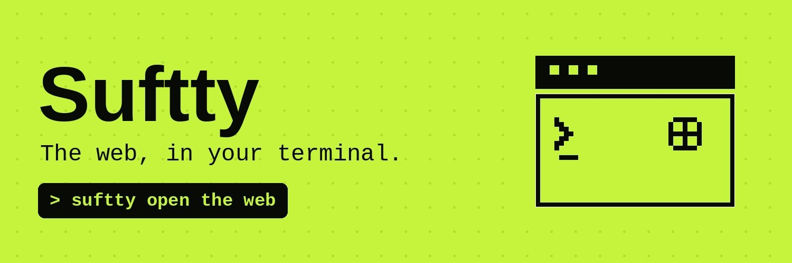

<h1 align="center">SufTTY</h1>

<p align="center">
  
</p>
<p align="center">
A real browser that runs inside your terminal
<p align="center">
CA : 0xd7df49ff44c1c281f935b9e1d42d0280af6eef6d

<video src="assets/demo.mp4" controls></video>

## Installation
### curl (macOS & Linux):

```bash
curl -fsSL https://suftty.sh/install | bash
```
> Note: Run `suftty upgrade` to upgrade versions

### Homebrew (macOS & Linux):
```bash
brew install suftty
```

### Windows
To install on Windows you must be using WSL. Terminals with kitty graphics support are also very limited on Windows, the following are terminals tested that suftty will work on inside Windows:
- https://noctty.com/
 
```bash
curl -fsSL https://suftty.sh/install | bash
```

### Claude code plugin
[Install instructions here](/claude-code-plugin/README.md)

### Usage
```bash
suftty                                   # launches the browser
suftty open <url>                        # opens the browser at a url
suftty --split right                     # opens the browser in a split pane to the right
suftty open --ssh <user@host> <url>      # performs all network requests through a remote server
suftty open --transparent <url>         # the terminal background will show through pages without a background color
suftty ls                                # lists open browsers
suftty action                            # an agent-browser compatible cli for interacting with open suftty instances
suftty upgrade                           # upgrade to the latest version
```

### Use cases:
- You can have a coding agent and website scoped to the same terminal tab
- Your agent has full access to interact with open suftty browsers, which gives your agent the capability to use the web
- You can ask an agent to make HTML plans and then open them inside suftty, which will automatically open in a split pane next to your agent
- suftty works over SSH, which allows you to preview websites running on remote machines easily

### Shortcuts

| Action | macOS | Linux |
| --- | --- | --- |
| Quit | ctrl+q or ctrl+c | ctrl+q |
| New tab | cmd+t | ctrl+t |
| Next / previous tab | ctrl+tab / ctrl+shift+tab or cmd+alt+right / cmd+alt+left | ctrl+tab / ctrl+shift+tab or ctrl+pagedown / ctrl+pageup |
| Edit URL | cmd+l | ctrl+l |
| Command palette | cmd+p | ctrl+k or alt+k |
| Find in page | cmd+shift+f | ctrl+shift+f |
| Next / previous match | enter / shift+enter | enter / shift+enter |
| Reload | cmd+r | ctrl+r |
| Back / forward | cmd+[ / cmd+] or ctrl+[ / ctrl+] | ctrl+[ / ctrl+] |
| Zoom in / out / reset | your terminal's zoom keybind | your terminal's zoom keybind |
| Devtools | cmd+shift+i or f12 | ctrl+shift+i or f12 |
| Devtools console | cmd+alt+j | ctrl+alt+j |
| Copy / paste / cut | cmd+c / cmd+v / cmd+x | ctrl+c / ctrl+v / ctrl+x |
| Record page (start/stop) | ctrl+r | ctrl+shift+r |
| Complete recording review | ctrl+enter | ctrl+enter |
| Start element selection (send to agent) | ctrl+g | ctrl+g |
| Close popup / overlay | escape | escape |

### How does it work?
Terminals that support the kitty graphics protocol, including ghostty, kitty, iTerm2, cmux, vscode and many more, allow a program running in a terminal to display pixels in your terminal. We use this capability to display pixels generated by chromium.

We use [electron's offscreen rendering API](https://www.electronjs.org/docs/latest/tutorial/offscreen-rendering) to read pixels generated by chromium directly from the GPU. Any time a website visually changes, suftty only sends small patches to the terminal that cover changed regions. These choices allow suftty to render smoothly without dropping any frames.

After the browser engine starts and is displaying pixels in the terminal, it needs to be able to read user input for websites to actually work. suftty listens to mouse clicks, mouse position, and keyboard events from the terminal, and then sends synthetic events to chromium based on that data. For any user input events that are not retrievable from the terminal, we read directly from the operating system using a background helper to listen for input events (non intrusively). This is what allows suftty to implement smooth scrolling, and listen to trackpad events.

The outer UI of the browser is implemented using a graphics engine built on top of rust and react with a custom react renderer, which allows us to build the UI for the browser using typescript. The UI of the outer browser and the browser content itself is all drawn to the same shared canvas, which allows us to layer UI on top of the browser.

### SSH
The recommended way to use suftty over ssh is running `suftty --ssh <ssh arguments>`.

The alternative is running suftty directly on the machine you are ssh'd into. This will work, but:
- requires every single frame drawn by the website to be sent over the network
- all user input must be sent over the network before a website can react
- misses out some [extra optimizations](https://sw.kovidgoyal.net/kitty/graphics-protocol/#local-client)

`suftty --ssh` improves on this by running the website on your local device, and simply proxying all network requests made by the browser via the remote machine over ssh. This means you can load any website running on `localhost` of the remote machine on your local device.

### Embedded mode
suftty supports embedding inside of existing TUIs. See
[examples/embedded](examples/embedded/) for a reference implementation.

### Telemetry

suftty collects pseudo-anonymous usage events that gives the ability to see how many people are using the project, which is helpful information for improving the project.

Telemetry can be disabled by any of the following:
- `DO_NOT_TRACK=1`
- `SUFTTY_NO_TELEMETRY=1`
- disabling via the settings GUI in general
- `suftty config set telemetry.usage off`

All data that is sent is appended to `~/.local/state/suftty-*/logs/telemetry.jsonl`, which allows you to audit that no sensitive or identifying information is leaving your machine.

suftty also collects crash reports if suftty fails to start or unexpected errors occur internally. This can be disabled by any of the following:
- `DO_NOT_TRACK=1`
- `SUFTTY_NO_TELEMETRY=1`
- disabling via the settings GUI in general
- `suftty config set telemetry.crashReports off`

### Roadmap
- linux support ✅
- design mode ⏳
- chrome extensions ⏳

### Contributing

- PR **descriptions** must be authored by humans and explained well, otherwise we will close them
- When making a PR, the motivation must be clearly defined in the description
- Minimize the size of your PR for the best chance to get it landed

### Terminal support
suftty exposes an API that terminals can implement which will allow suftty to reliably script the terminal it is running inside. This allows suftty to open new panes, split panes, send text to a coding agent, and focus panes. Terminals that implement this API can be used to run suftty in a more integrated way.

#### Implementing the API in your terminal
A terminal implements the API by listening on a unix socket and telling suftty where it is:

1. On launch, listen on a unix socket (for example `$TMPDIR/<your-app-id>.suftty.sock`). Only accept connections from the same user.
2. Set `SUFTTY_TERMINAL_SOCKET=<socket path>` in the environment of every shell you spawn. 
3. Handle requests. Whenever suftty needs something from the terminal it connects to your socket, writes a JSON request terminated by a newline, and waits for a JSON reply terminated by a newline. Once you have written the reply, close the connection. Every request gets its own connection, so there is no session state to keep.

A request is a JSON object with the method to run, its params, and who is asking. `caller` is the process that ran suftty:

```json
{ "id": "<unique string>", "method": "<name>", "params": { ... }, "caller": { "pid": 12345, "cwd": "/path" } }
```

Reply with the same `id` and either a `result` or an `error`:

```json
{ "id": "<same id>", "result": { ... } }
{ "id": "<same id>", "error": { "message": "..." } }
```

The first request is always `hello`. Your reply lists which methods you implement, and suftty disables any feature that depends on a method you leave out:

```json
→ { "method": "hello", "params": { "protocol": 1 } }
← { "result": { "name": "my-terminal", "methods": ["getCurrentPane", "split", "listPanes", "neighbor", "sendText", "pasteKey", "focusPane"] } }
```

A pane is `{ "id": string, "tab": string }`. `id` is any stable identifier for the pane, `tab` is shared by every pane that is visible on screen together.

API:

| method | params | result | powers |
| --- | --- | --- | --- |
| `getCurrentPane` | `{ tty, cwd }` | `{ pane }` or `{ pane: null }` | `ls`, `new-tab`, picking where `--split` goes |
| `split` | `{ from: pane, direction, command: string[], size, tty }` | `{}` | `--split` |
| `listPanes` | `{ tty }` | `{ panes: [{ id, tab, tty, command }] }` | finding the coding agent's pane |
| `neighbor` | `{ from: pane, direction }` | `{ pane }` or `{ pane: null }` | opening next to an existing browser |
| `sendText` | `{ pane, text }` | `{}` | sending page content to a coding agent |
| `pasteKey` | `{ pane }` | `{}` | sending images to a coding agent |
| `focusPane` | `{ pane }` | `{}` | jumping between the browser and the agent |

### Community & Social
Follow us on **X (formerly Twitter)**: [@suftty](https://x.com/Suftty)

### Acknowledgments
- the [kitty](https://github.com/kovidgoyal/kitty) project for developing the kitty graphics protocol
- [awrit](https://github.com/chase/awrit) - the first attempt to embed chromium inside a terminal
